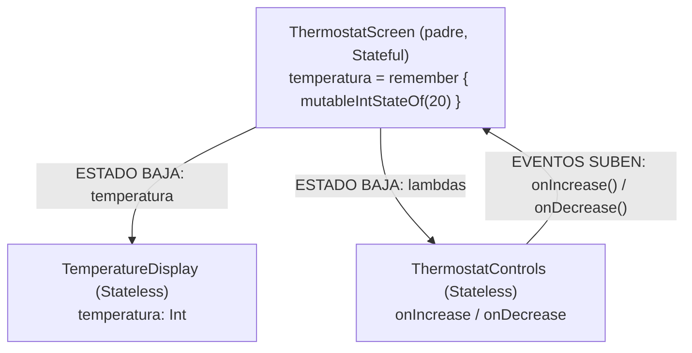

# Laboratorio 5.2 / 5.3 — Reto: Implementación de un Termostato Inteligente

> **Asignatura:** Desarrollo de Aplicaciones Móviles · **Plataforma:** Android (API 36) · **Lenguaje:** Kotlin · **UI:** Jetpack Compose
>
> **Dirigido a:** Integrantes del equipo responsables de la elaboración del informe técnico en PDF.
>
> **Código fuente principal:** [`MainActivity.kt`](app/src/main/java/com/example/myapplication/MainActivity.kt)

Este documento describe la arquitectura implementada en el reto del termostato y establece, de forma obligatoria, las evidencias y la estructura que debe contener el informe final.

---

## Tabla de contenidos

1. [Preparación del Entorno (Scaffolding)](#1-preparación-del-entorno-scaffolding)
2. [Paradigma Declarativo y Gestión de Estado](#2-paradigma-declarativo-y-gestión-de-estado)
3. [Arquitectura State Hoisting y Flujo Unidireccional (UDF)](#3-arquitectura-state-hoisting-y-flujo-unidireccional-udf)
4. [Guía de Entregables para el Equipo de Documentación](#4-guía-de-entregables-para-el-equipo-de-documentación-obligatorio)

---

## 1. Preparación del Entorno (Scaffolding)

Para no partir de cero y garantizar una configuración homogénea en todo el equipo, se aplicó una **herencia de plantilla** a partir del proyecto del Laboratorio 1.

### 1.1 Procedimiento aplicado

| Paso | Acción | Propósito |
|:---:|---|---|
| 1 | Se clonó (copió) la carpeta del proyecto del Laboratorio 1 y se renombró como `Lab5.3_Reto_NombreApellido`. | Reutilizar una estructura de proyecto ya configurada y funcional. |
| 2 | Se eliminaron los directorios **`.gradle/`**, **`.idea/`** y **`build/`**. | Limpiar la caché de compilación, los índices del IDE y los artefactos generados que contienen rutas absolutas del proyecto original. |
| 3 | Se abrió el proyecto en **Android Studio Ladybug** y se ejecutó *Sync Project with Gradle Files*. | Regenerar la caché y los metadatos del IDE desde cero, evitando conflictos de rutas o de nombres heredados. |

### 1.2 Configuración conservada ("blindaje" del proyecto)

Al no modificar los archivos de Gradle, la plantilla mantiene intacta la configuración validada en laboratorios anteriores (`app/build.gradle.kts`):

```kotlin
android {
    compileSdk = 36              // Compilación contra Android API 36
    defaultConfig {
        minSdk = 26
        targetSdk = 36           // Comportamiento de ejecución de API 36
    }
    compileOptions {
        sourceCompatibility = JavaVersion.VERSION_21   // Blindaje Java 21
        targetCompatibility = JavaVersion.VERSION_21
    }
    kotlinOptions { jvmTarget = "21" }
    buildFeatures { compose = true }                   // Jetpack Compose habilitado
}
```

> [!NOTE]
> Eliminar `.gradle`, `.idea` y `build` **no borra código fuente**; únicamente fuerza a Android Studio y a Gradle a reconstruir información temporal. Es una práctica estándar al reutilizar un proyecto como plantilla.

---

## 2. Paradigma Declarativo y Gestión de Estado

### 2.1 Del enfoque imperativo al declarativo

En el enfoque **imperativo** tradicional, la interfaz se define en archivos XML y el desarrollador debe localizar cada vista con `findViewById` y modificarla manualmente cada vez que cambian los datos:

```kotlin
// Enfoque imperativo (NO utilizado en este laboratorio)
val txtTemp = findViewById<TextView>(R.id.txtTemp)
temperatura++
txtTemp.text = "$temperatura °C"          // Actualización manual
txtTemp.setTextColor(if (temperatura >= 25) Color.RED else Color.BLUE)
```

Este modelo presenta un problema estructural: existen **dos fuentes de verdad** (la variable lógica y la vista). Si el programador olvida actualizar la vista, se produce una **desincronización entre el estado lógico y la interfaz**.

Con **Jetpack Compose** (paradigma **declarativo**), la interfaz se describe como una **función del estado**:

> **UI = f(estado)**

El desarrollador declara *cómo debe verse* la pantalla para un estado dado, y el framework se encarga de actualizarla automáticamente cuando dicho estado cambia. En este laboratorio **no existe ningún archivo XML de diseño ni llamada a `findViewById`**.

### 2.2 `remember` y `mutableIntStateOf(20)` en `ThermostatScreen`

El estado del termostato se declara en el componente padre:

```kotlin
@Composable
fun ThermostatScreen(modifier: Modifier = Modifier) {
    var temperatura by remember { mutableIntStateOf(20) }
    // ...
}
```

| Elemento | Función |
|---|---|
| `mutableIntStateOf(20)` | Crea un **contenedor de estado observable** de tipo entero con valor inicial de 20 °C. Actúa como un **observador reactivo**: cuando su valor cambia, notifica a Compose que debe redibujar las partes de la UI que lo leen. Al ser específico para `Int`, evita el *autoboxing* y es más eficiente que `mutableStateOf<Int>`. |
| `remember { ... }` | **Conserva el valor entre recomposiciones**. Sin `remember`, cada vez que la función se volviera a ejecutar, la temperatura se reiniciaría a 20. |
| `by` (delegación) | Permite leer y escribir `temperatura` como un `Int` normal (`temperatura++`) sin acceder explícitamente a `.value`. |

### 2.3 Recomposición Inteligente

Compose funciona de manera análoga a una **hoja de cálculo de Excel**:

- En Excel, si la celda `A1` cambia, **solo se recalculan las celdas cuyas fórmulas dependen de `A1`**; el resto de la hoja permanece intacto.
- En Compose, cuando `temperatura` cambia, **no se destruye ni se reconstruye toda la pantalla**. El framework identifica qué funciones `@Composable` leyeron ese estado y **solo vuelve a ejecutar (recompone) esos nodos**.

En el termostato, al pulsar *Subir*, se recompone `TemperatureDisplay` (texto, color e ícono), mientras que elementos que no dependen del estado —como el título "Termostato Inteligente" o la estructura de los botones— pueden omitirse en la recomposición. Además, **la `Activity` nunca se recarga**, lo que se evidenciará en la Captura 2.

---

## 3. Arquitectura State Hoisting y Flujo Unidireccional (UDF)

### 3.1 State Hoisting (Elevación de estado)

El patrón **State Hoisting** consiste en **mover el estado al componente padre común** de quienes lo necesitan, de modo que los componentes hijos queden **sin estado interno (Stateless)** y reciban todo lo necesario por parámetros.

| Componente | Tipo | Responsabilidad |
|---|---|---|
| `ThermostatScreen` | **Stateful** (padre) | Es la **única fuente de verdad**: posee la variable `temperatura` y define cómo se modifica. |
| `TemperatureDisplay` | **Stateless** (hijo 1) | Solo **visualiza** el valor recibido. |
| `ThermostatControls` | **Stateless** (hijo 2) | Solo **notifica** las acciones del usuario. |

**Ventajas académicas del patrón:**

- **Única fuente de verdad:** se elimina cualquier posibilidad de estados contradictorios.
- **Reutilización:** los hijos pueden usarse en otras pantallas con otros datos.
- **Testabilidad y previsualización:** un componente Stateless produce siempre la misma UI para los mismos parámetros.
- **Separación de responsabilidades:** visualización, interacción y lógica de estado quedan desacopladas.

### 3.2 Flujo de Datos Unidireccional (UDF)



#### ⬇️ El estado baja

El hijo de visualización recibe **únicamente el entero** de la temperatura y evalúa declarativamente qué mostrar:

```kotlin
@Composable
fun TemperatureDisplay(temperatura: Int) {
    val esCalor = temperatura >= 25
    val icono = if (esCalor) IconoSol else IconoCopoNieve
    val colorIcono = if (esCalor) Color.Red else Color.Blue
    // Icon(...) y Text("$temperatura °C") se dibujan según estas condiciones
}
```

| Condición | Texto | Ícono | Color |
|---|---|---|---|
| `temperatura >= 25` | `"$temperatura °C"` + "Calor" | ☀️ Sol | `Color.Red` |
| `temperatura < 25` | `"$temperatura °C"` + "Frío" | ❄️ Copo de Nieve | `Color.Blue` |

> [!NOTE]
> Los íconos de Sol y Copo de Nieve **no existen** en la librería base `androidx.compose.material.icons.Icons`. Para no añadir la dependencia `material-icons-extended` (y no modificar Gradle), se dibujaron como **vectores propios** mediante `ImageVector.Builder` (`IconoSol` e `IconoCopoNieve`). El color se aplica con el parámetro `tint` del componente `Icon`.

#### ⬆️ Los eventos suben

El hijo de controles **no contiene lógica ni estado**. Sus botones solo ejecutan las funciones lambda recibidas del padre, *solicitando* el cambio:

```kotlin
// En el padre:
ThermostatControls(
    onIncrease = { temperatura++ },
    onDecrease = { temperatura-- }
)

// En el hijo:
@Composable
fun ThermostatControls(onIncrease: () -> Unit, onDecrease: () -> Unit) {
    Button(onClick = onDecrease) { Text("Bajar") }
    Button(onClick = onIncrease) { Text("Subir") }
}
```

**Ciclo completo:** el usuario pulsa *Subir* → `ThermostatControls` ejecuta `onIncrease()` → el padre incrementa `temperatura` → `mutableIntStateOf` notifica el cambio → Compose recompone `TemperatureDisplay` con el nuevo valor.

### 3.3 Estructura visual: `Modifier.padding` y `Spacer`

| Herramienta | Uso en el proyecto |
|---|---|
| `Modifier.padding(innerPadding)` | Respeta las áreas seguras del sistema (barra de estado y navegación) entregadas por el `Scaffold`. |
| `Modifier.padding(24.dp)` | Margen interior general de la `Column` principal. |
| `Modifier.padding(horizontal = 16.dp)` | Margen lateral de la fila de botones. |
| `Spacer(Modifier.height(...))` | Separación vertical entre título, visualización y controles (32 dp) y entre ícono y texto (16 dp). |
| `Spacer(Modifier.width(24.dp))` | Separación horizontal entre los botones *Bajar* y *Subir*. |
| `Modifier.height(48.dp)` en botones | Área táctil cómoda (≥ 44 dp), alineada con las pautas de accesibilidad. |

---

## 4. Guía de Entregables para el Equipo de Documentación (¡Obligatorio!)

> [!IMPORTANT]
> Antes de ejecutar, verifiquen que el proyecto compile en Android Studio (*Build › Make Project*). Si Gradle reporta incompatibilidades de versiones de dependencias en `gradle/libs.versions.toml`, notifíquenlo al líder técnico **antes** de tomar las capturas.

### 📸 Captura 1 — Estado Frío

1. Iniciar un emulador con **Android API 36** desde *Device Manager*.
2. Ejecutar la aplicación (*Run 'app'* ▶).
3. **Sin presionar ningún botón**, tomar la captura en el valor inicial de **20 °C**.
4. **Debe evidenciarse:** el texto de la temperatura (< 25 °C) y el **ícono de Copo de Nieve en color Azul**.

> Título sugerido: *Figura 1. Estado frío del termostato con temperatura inicial de 20 °C.*

### 📸 Captura 2 — Estado Calor

1. Con la app aún abierta, presionar el botón **Subir** hasta alcanzar **25 °C o más** (5 pulsaciones desde 20 °C).
2. Tomar la captura.
3. **Debe evidenciarse:** el **cambio instantáneo** del texto y del **ícono a Sol en color Rojo**, **sin recargar la actividad** (demostración práctica de la recomposición inteligente).

> Título sugerido: *Figura 2. Estado de calor del termostato al alcanzar 25 °C mediante recomposición.*

> [!TIP]
> Para capturar desde el emulador, usen el ícono de cámara 📷 del panel lateral del emulador o *Running Devices › Take Screenshot* en Android Studio. Recorten la imagen para mostrar solo la pantalla del dispositivo.

### 📄 Estructura del PDF (Normas APA 7.ª edición)

**Formato general:** portada APA de estudiante, fuente Times New Roman 12 pt (o Calibri 11 pt), interlineado doble, márgenes de 2,54 cm, numeración de páginas en la esquina superior derecha.

| Sección del informe | Contenido | Fuente en este README |
|---|---|---|
| Portada | Título, integrantes, asignatura, docente, institución y fecha. | — |
| Introducción | Objetivo del reto y contexto del paradigma declarativo. | Sección 1 y 2.1 |
| **Análisis técnico** | Gestión de estado, recomposición, State Hoisting y UDF, con fragmentos de código y las Figuras 1 y 2. | **Secciones 2 y 3** |
| **Conclusiones** | Síntesis de lo aprendido: única fuente de verdad, eliminación de la desincronización, componentes Stateless reutilizables. | **Secciones 2 y 3** |
| **Recomendaciones** | Propuestas de mejora: límites de temperatura (mín./máx.), uso de `rememberSaveable` o `ViewModel` para persistir ante rotaciones, pruebas de UI. | **Secciones 2 y 3** |
| Referencias | Lista en formato APA 7 con sangría francesa. | Ver ejemplos abajo |
| Anexo A | Código completo de `MainActivity.kt`. | — |

**Formato de figuras (APA 7):** número de figura en **negrita**, título en *cursiva* en la línea siguiente, imagen y, opcionalmente, una *Nota.* debajo.

**Referencias sugeridas:**

- Google. (s.f.). *State and Jetpack Compose*. Android Developers. https://developer.android.com/develop/ui/compose/state
- Google. (s.f.). *Thinking in Compose*. Android Developers. https://developer.android.com/develop/ui/compose/mental-model
- Google. (s.f.). *Where to hoist state*. Android Developers. https://developer.android.com/develop/ui/compose/state-hoisting

### 📎 Anexo y Repositorio

1. **Anexo A — Código fuente:** copiar **íntegramente** el contenido de [`MainActivity.kt`](app/src/main/java/com/example/myapplication/MainActivity.kt) al final del informe, con fuente monoespaciada (Consolas o Courier New, 10 pt) para preservar la indentación.
2. **Repositorio público:** incluir la URL del repositorio y el enlace al **commit final**:
   - Repositorio: https://github.com/eisefaaabri/RDA2_Lab5.2_Integrador_Implementaci-n-de-un-Termostato-Inteligente
   - Commit final: en GitHub, ir a **Commits**, abrir el último commit y copiar su URL con el formato `https://github.com/eisefaaabri/RDA2_Lab5.2_Integrador_Implementaci-n-de-un-Termostato-Inteligente/commit/<hash>`.

### ✅ Lista de verificación antes de entregar

- [ ] Captura 1: 20 °C, ícono Copo de Nieve **azul**.
- [ ] Captura 2: ≥ 25 °C, ícono Sol **rojo**, sin recargar la actividad.
- [ ] Figuras numeradas y tituladas según APA 7.
- [ ] Análisis técnico, conclusiones y recomendaciones basados en las secciones 2 y 3.
- [ ] Referencias en formato APA 7.
- [ ] Anexo A con el código completo de `MainActivity.kt`.
- [ ] URL del repositorio y del commit final incluidas.
